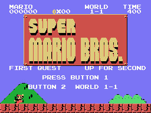
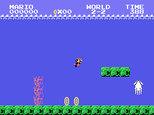

# Super Mario Bros. for the Sega SG-1000

**[Download the playable cartridge: smb1.sg](cartridge/smb1.sg)** (48 KiB). Open the `.sg` file in Gearsystem in SG-1000 mode. No NES ROM, BIOS, or RAM expansion is needed.



| Controller 1 | Action |
| --- | --- |
| Left / Right | Walk |
| Button 1 | Hold to clear a four-block ledge from a standstill; release early for a short hop. Tap to swim underwater. |
| Button 2 | Hold to run; press to shoot as Fire Mario. |
| Down | Enter a connected pipe while standing on its mouth. |
| Button 1 on the title | Start the selected course. |
| Button 2 on the title | Advance one level: 1–4, then the next world. After 8-4 it wraps to 1-1. |
| Either button on Game Over or the final victory screen | Return to title early. |

The cartridge follows the **32-stage, eight-world main route** using SMB1Base’s area streams, halfway points and CHR art. Mario accelerates and brakes with fractional velocity; speed and button hold affect the jump arc. In 1-3 the girders move and carry Mario. In 1-2 you can ride an elevator above the ceiling, run over the exit and drop down to the warp pipes. The Starman bounces out of its brick and grants temporary contact invincibility.

Course starts, retries, and warp-zone arrivals show a timed black **WORLD / Mario × lives** card. No button press is needed. On first entry to 1-2, 2-2, 4-2 and 7-2, Mario walks out of the castle and into the sideways pipe while only the overworld lead-in plays. Underground and underwater music start on arrival. A retry resumes the course without repeating the walk, and ordinary bonus-pipe trips stay within the current course. [Preview the 1-2 entrance in Gearsystem.](sg1000/pipe-intro.gif)

A fatal hit freezes the action: Mario pauses, pops up, then falls through the floor while the death tune plays. A pit fall stays offscreen instead. When the clock goes from 100 to 099, the hurry-up cue plays and the course music resumes faster. At 000, Mario goes through the death sequence before the black **TIME UP** screen, then the lives card or **GAME OVER** on his last life. [Watch a timeout in Gearsystem.](sg1000/time-up.gif)

In **2-2 and 7-2**, the waterline is visible just below the HUD. Tap Button 1 to swim through the coral, collect submerged coins and dodge Bloopers and Cheep Cheeps. The shared enemy command launches fish here and Bullet Bills on land. The title waits in silence; starting an overworld course plays the opening phrase before the main loop.



The camera now steps by **8 pixels rather than 16**. It is not pixel-smooth or frame-identical to the NES. The SG-1000 video chip has no scroll registers, permits two background colors per eight-pixel scanline, and displays only four sprites per scanline. Mario uses streamed standing, walking, skidding, jumping, swimming, crouching, throwing, climbing, transformation and death poses. The renderer keeps the source background palette slots and maps them to SG inks on area changes, including water, underground, castle, snow and mushroom palettes. The score uses the SN76489’s three tones for lead, harmony and bass, with short noise percussion where the source provides it. Courses, Starman, death and clear jingles have their own arrangements; gameplay sound effects are muted. Enemy behavior and boss fights are simplified; vine/cloud routes and castle loops are not implemented.

### Rebuild

Use Python 3.10+, GNU Make and [SjASMPlus](https://github.com/z00m128/sjasmplus) (tested with 1.21.1):

```sh
make sg1000-tools   # optional: build a local assembler with Git and a C++ compiler
make sg1000         # writes build/smb1.sg
make sg1000-test    # verify the assembled ROM against the source area tables
```

For a controller-driven emulator test, run `make sg1000-test GEARSYSTEM_CORE=/path/to/gearsystem_libretro.so`. The recorded pad inputs clear 1-1 both overland (collecting Starman) and through the bonus pipe, take the 1-2 roof to world 2, and clear 1-3 using moving lifts. It also checks an enemy spawn in 2-1, swims through both 2-2 and 7-2, clears the lava pits and Bowser bridge in 2-4, bounces Mario off the 5-2 spring and checks that he disappears above the screen and returns on descent. It also checks audio output, title wraparound, life loss and restart. Tested in Gearsystem; not verified on a physical console.

The native code is in [`sg1000/`](sg1000/). It uses 1 KiB of work RAM and 16 KiB of VRAM. Sixteen mutable columns stream from cartridge ROM. Overlapping column data share cartridge storage without runtime decompression. The renderer prepares the next name table, sprite attribute table and changed Mario pose offscreen. It switches the tables together at vertical blank during play, so a scrolling background doesn’t get a frame ahead of its sprites.

---

## Original NES project: SMB1Base

## ROM Hacking friendly version of SMB1

### What is this project?

Super Mario Bros. for the NES is a classic game and a popular game for ROM hackers to modify.
This repository is a collection of several new features and patches added to the original game to make
it easier to add new content and expand on what the original was capable of.
The goal is to make it both easy and fun to stretch the boundaries of whats possible when making a
mod for Mario!

### Features

- Easy to build; just run `build.sh` or `build.bat`

- Flexible feature set (check out `options.s` for all available options!)

- Multiple optional audio engines available to allow importing songs from modern tools like Famitracker or Famistudio
  - The latest DN famitracker is supported through bhop (https://github.com/Dn-Programming-Core-Management/Dn-FamiTracker/releases/)
  - Famistudio support is kept up to date with the latest (https://famistudio.org/)
  - Also supports using custom music engines along side the vanilla sound effect engine, since nothing can really replicate the crisp SFX from vanilla better than the vanilla engine.

- New code features including the following:
  - 8x16 sprite mode in use to double the maximum number of sprites on screen
  - New metasprite based rendering code to make it easy to add new enemies and animations to the game
  - Anti-lag code to hide lag frames and get smoother gameplay
  - RAM values are relocatable, making it easy to add new content that needs RAM

- Level data importer for use with tools like Greated or SMBUtil

- Code is split into banks of 8kb with only 16kb of fixed space required.
  - This frees up the $c000 region to be used for banked DPCM

- Minor optimizations for the original game, removing residual code and cleaning up some small oddities

- Optional VSCode integration with the following features
  - Syntax highlighting
  - Inline error reporting (error squigglies you can hover to see whats wrong)
  - Automatic compile on save

### How to use

### Features I want to have someday

- Sooner than later
  - Optional bugfixes for the vanilla game to disable
  - CC65 support (add C headers and callback/hook locations that can call into C code)
- Long term goals
  - Optional Tiled based level data for easily making levels without using vanilla mario data
  - Optional 4-way scrolling for interesting new maps
  - Code changes
    - use popslide for faster VRAM updates
    - increase number of enemy slots
